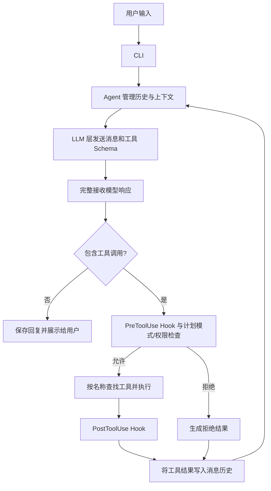

# CodeHeron

**基于大模型工具调用的命令行 AI 编程助手。**

CodeHeron 在终端中接收自然语言任务，通过「请求模型 → 执行工具 → 回传结果 → 再次请求模型」的循环，完成代码阅读、文件编辑、命令执行和网页内容获取。支持 OpenAI 兼容接口，已使用阿里云百炼的 `qwen-plus` 验证基本对话与工具调用。

## 功能

- **Agent 执行循环**：管理消息历史、分发工具调用、回传执行结果，并限制单次任务的最大循环轮数。
- **流式模型响应**：逐步展示文本，汇总完整的工具调用参数后再执行工具；对部分临时请求错误和流式中断进行重试。
- **统一工具接口**：工具提供名称、说明、参数 Schema 和 `execute()` 方法。内置工具与 MCP 工具接入同一调度流程。
- **多工具执行**：同一轮返回多个工具调用时使用线程池执行；文件写入和编辑通过共享锁串行化。
- **权限与计划模式**：工具执行前经过 Hooks 和权限检查，计划模式仅放行允许名单中的工具。
- **上下文管理**：结合工具结果裁剪、旧对话摘要和紧急压缩控制上下文长度。
- **会话与文件恢复**：保存、恢复对话历史；文件编辑和写入记录检查点，支持撤销最近一次文件变更。
- **子 Agent**：使用独立对话历史处理子任务，复用父 Agent 的模型、权限和 Hooks。
- **网页与 API 文本获取**：支持 HTTP/HTTPS GET、HTML 文本提取和 JSON 格式化，并限制响应体大小与返回文本长度。

## 快速开始

需要 Python **3.10 或更新版本**。以下命令以 Windows PowerShell 为例。

### 1. 获取代码并安装

```powershell
git clone https://github.com/prnck1/CodeHeron.git
cd CodeHeron
python -m venv .venv
.\.venv\Scripts\Activate.ps1
python -m pip install -e ".[dev]"
```

`[dev]` 包含测试依赖；仅运行真实模型时可以使用 `python -m pip install -e .`。已有 Conda 环境的用户可以激活自己的环境后安装，无需另外创建 `.venv`。

### 2. 配置模型

首次使用时复制配置模板：

```powershell
Copy-Item .env.example .env
```

编辑项目根目录的 `.env`，填入自己的百炼北京地域 API Key：

```dotenv
CODEHERON_PROVIDER=openai
CODEHERON_API_KEY=your_api_key_here
OPENAI_BASE_URL=https://dashscope.aliyuncs.com/compatible-mode/v1
CODEHERON_MODEL=qwen-plus
```

这里的 `openai` 表示使用 OpenAI 兼容接口，实际请求发送到 `OPENAI_BASE_URL` 指定的服务。切换服务时，需要同时匹配该服务的地址、密钥和支持工具调用的模型。

`.env` 已加入 Git 忽略规则；仓库仅提供不含密钥的 `.env.example`。已有进程环境变量的优先级高于 `.env`。

### 3. 启动

```powershell
python -m codeheron
```

安装后也可以直接运行 `codeheron`。在交互提示符中输入任务，例如：

```text
请读取 codeheron/tools/fetch_url.py，用中文说明输入参数、处理流程和返回结果。不要修改文件。
```

```text
请使用 fetch_url 读取 https://example.com，根据实际返回内容说明网站用途。
```

编辑文件、执行命令、调用 `fetch_url` 等不在默认允许名单中的操作会请求授权。可选择允许一次、始终允许该工具或拒绝。

## 运行方式

| 方式 | 命令 | 说明 |
| --- | --- | --- |
| 交互模式 | `python -m codeheron` | 连续对话并按需确认工具调用 |
| 单次任务 | `python -m codeheron -p "读取 pyproject.toml，概括项目依赖"` | 默认拒绝需要交互授权的工具 |
| 离线演示 | `python -m codeheron --demo` | 无需 API Key，使用预设模型响应驱动真实工具循环 |
| 恢复会话 | `python -m codeheron -r <session_id>` | 加载 `/save` 保存的会话 |
| 查看参数 | `python -m codeheron --help` | 查看全部 CLI 参数 |

离线演示在临时目录中创建 `fib.py` 和测试文件，再调用命令工具运行 pytest。它用于展示执行流程，不代表真实模型的推理效果；运行后会显示保留的临时目录路径。

`--yes` 会自动允许工具调用，适合已明确执行范围的脚本场景。正常交互使用默认的确认机制即可。

## 工作流程



模型返回工具名称和参数，由 Agent 调用已经注册的 Python 工具实现。工具结果会作为 `role=tool` 消息进入后续模型请求。模型不再返回工具调用时，本次 `chat()` 结束；达到轮数上限时也会停止。

## 内置工具

| 工具 | 用途 |
| --- | --- |
| `read_file` | 按行号返回文件内容，支持 `offset` 和 `limit` |
| `write_file` | 写入文件并记录检查点 |
| `edit_file` | 基于唯一文本匹配进行替换，返回变更差异 |
| `glob` | 根据路径模式查找文件 |
| `grep` | 在文件中搜索文本模式 |
| `bash` | 执行命令，处理超时、输出和工作目录 |
| `todo_write` | 维护任务清单 |
| `agent` | 委派子任务并返回文本结果 |
| `fetch_url` | 获取网页或 API 的文本内容 |

`fetch_url` 接受 `text/*`、`application/json` 和 `+json` 类型。HTML 处理会移除 `script`、`style` 和 `template` 元素；JSON 会先解析校验，再格式化输出。响应体上限为 1,000,000 字节，处理后的正文最多保留 12,000 个字符，超出时附加截断提示。

## 交互命令

| 命令 | 功能 |
| --- | --- |
| `/help` | 查看帮助 |
| `/plan` | 切换计划模式 |
| `/model`、`/model <name>` | 查看或切换当前模型 |
| `/tokens` | 查看 Token 用量；有对应价格数据时显示估算费用 |
| `/compact` | 按上下文阈值尝试压缩历史 |
| `/save`、`/sessions` | 保存会话、列出已保存会话 |
| `/diff` | 列出本次进程中记录的变更文件 |
| `/undo` | 撤销最近一次记录的文件变更 |
| `/reset` | 清空当前对话和任务清单 |
| `quit` | 退出 |

命令区分大小写。会话、权限和检查点存放于用户主目录下的 `.codeheron`，输入历史存放于 `.codeheron_history`。

## 代码结构

```text
codeheron/
├── cli.py           # CLI 参数、交互命令、终端输出
├── agent.py         # Agent 主循环、权限检查、工具调度
├── llm.py           # 模型请求、流式响应解析、重试
├── config.py        # 环境变量和 .env 配置
├── context.py       # Token 估算与上下文压缩
├── permissions.py   # 工具授权与持久化
├── checkpoints.py   # 文件检查点与撤销
├── session.py       # 会话保存与恢复
├── hooks.py         # 工具调用前后 Hooks
├── mcp.py           # stdio MCP 客户端与工具适配
├── demo.py          # 离线预设演示
└── tools/           # 工具接口、注册列表与具体实现
tests/               # 自动化测试
examples/            # 计划模式和 Hooks 使用示例
```

新增工具时，实现 `Tool` 接口并注册到 `tools/__init__.py` 的 `ALL_TOOLS`；Agent 从工具实例生成 Schema 并传给模型，无需为每种工具修改主循环。授权策略需要单独评估，不能仅凭工具描述决定是否自动放行。

扩展配置入口为 `~/.codeheron/hooks.json` 和 `~/.codeheron/mcp.json`。具体格式见 [Hooks 实现](codeheron/hooks.py)、[MCP 实现](codeheron/mcp.py) 和 [使用示例](examples/plan_hooks_demo.py)。

## 测试

```powershell
python -m pip install -e ".[dev]"
python -m pytest -q
```

当前测试集包含 213 项测试，覆盖 Agent 循环、工具系统、权限、计划模式、Hooks、MCP 适配、上下文处理、会话与文件检查点等。测试中的模拟模型响应不能代替真实模型和网络服务的集成验证。

## 当前边界

- 权限确认和计划模式属于应用层控制，项目未提供操作系统沙箱；子 Agent 隔离对话历史，但共享本机文件系统。
- 同一轮多个工具调用可能并发执行，调度器不自动分析依赖关系；需要前一步结果的操作应放到后续轮次。
- `read_file` 当前先读取完整文件，再按行裁剪结果，`limit` 不限制读取阶段的内存占用。
- `fetch_url` 不执行网页 JavaScript，不支持登录态浏览；当前没有完整的内网地址与重定向访问限制，不适合作为开放给不可信用户的网络代理。
- 工具返回结果与模型最终结论是两个环节，模型可能补充或误解信息；代码修改仍需结合差异检查和实际测试验证。

技术栈：Python、OpenAI Python SDK、Rich、prompt_toolkit、BeautifulSoup、pytest；可选 LiteLLM 适配。
